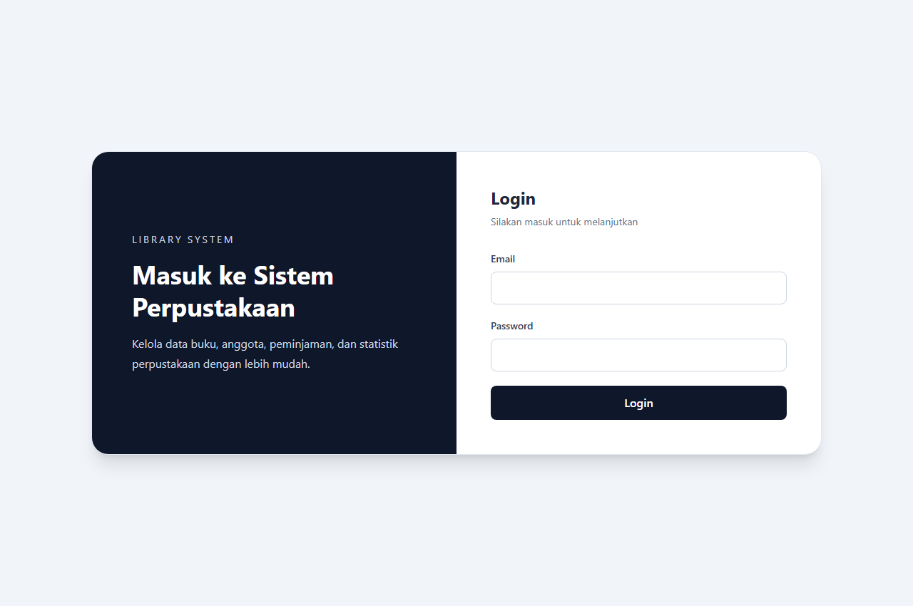
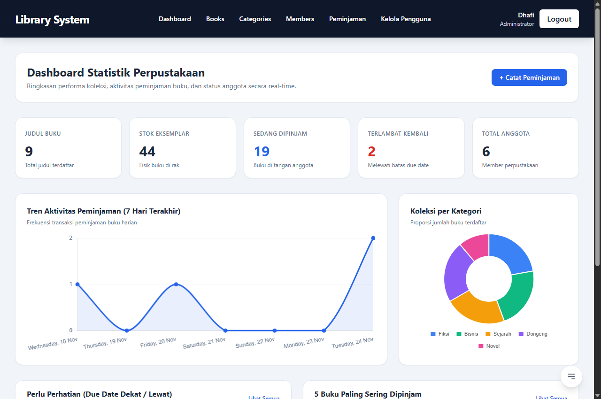
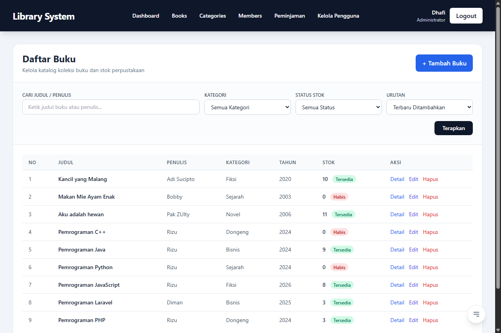
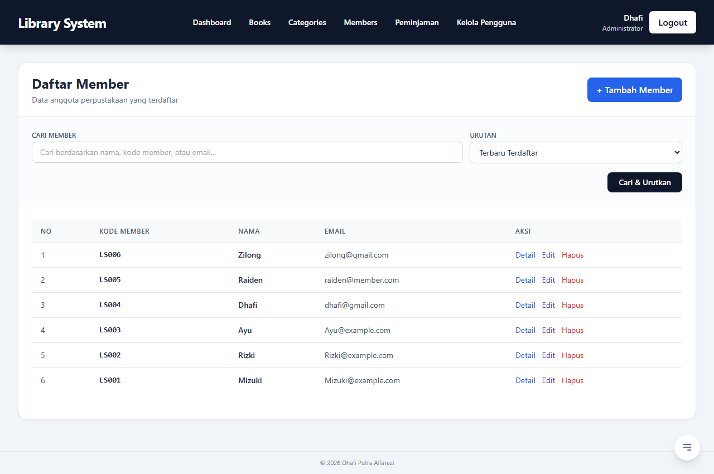
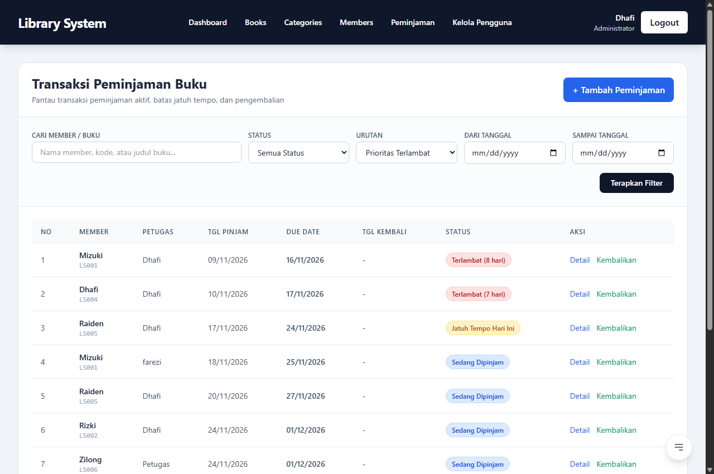

# Library System

Web-based library management system built with Laravel 13 and PHP 8.5. The application provides book inventory management, category classification, member registration, and borrowing and return circulation with role-based access control.

---

## Exact Tech Stack Versions

* **PHP**: 8.5 (Runtime: PHP 8.5.10)
* **Framework**: Laravel 13.30 (Laravel Framework 13.30.1)
* **Database**: MySQL (InnoDB engine, utf8mb4)
* **Template Engine**: Blade
* **Asset Bundler**: Vite
* **Styling**: Tailwind CSS
* **Charts**: Chart.js 4.4
* **Package Managers**: Composer 2.4.1, NPM 11.1.0

---

## Verified Features

### 1. Authentication and Role-Based Access Control
* Session-based login and logout with CSRF protection.
* Unauthenticated access to protected routes (`/dashboard`, `/books`, `/categories`, `/members`, `/borrowings`, `/users`) automatically redirects to `/login`.
* Role separation enforced via `RoleMiddleware`:
  * **Admin**: Unrestricted access including user management (`/users`) and category write operations (`/categories` create, store, edit, update, destroy).
  * **Petugas**: Operational access for books, members, and borrowings, with read-only access to categories (`/categories`). Direct access to `/users` or category write routes returns HTTP 403 Forbidden.
* Self-deletion safeguard in `UserController::destroy` preventing administrators from deleting their own active accounts.
* Session regeneration on login to prevent session fixation and token invalidation on logout.

### 2. Dashboard Analytics
* Summary metric cards: Total unique book titles, total physical book stock, total registered members, active borrowed books count, overdue loans count, and monthly loan counts.
* 7-day borrowing trend line chart tracking daily circulation volume.
* Category collection distribution chart visualizing book proportions.
* Top 5 most frequently borrowed books table.
* Urgent loan monitor listing overdue borrowings and loans due within 48 hours.

### 3. Book Inventory Management
* Full CRUD operations for library catalog entries.
* Search filter supporting keyword matching on title and author fields.
* Dropdown filters for category selection, stock status (available or out of stock), and publication year.
* Sorting options by title, author, publication year, stock quantity, and creation date.
* Server-side request validation ensuring title, author, year (minimum 2000), stock (minimum 0), and valid category ID.

### 4. Category Management
* Category listings with book counts (`withCount('books')`).
* Dedicated creation, edit, update, and deletion forms restricted to Admin accounts.
* Read-only tabular view accessible to Petugas staff.

### 5. Member Management
* Member directory with name and unique email storage.
* Automated sequential code assignment (`LS001`, `LS002`, `LS003`, etc.) generated via `Member::generateNextMemberCode()`.
* Search functionality across member codes, member names, and email addresses.
* Sorting by name, member code, email, or creation date.
* Member detail view showing complete loan history and associated books.

### 6. Borrowing and Return Circulation
* Multi-book loan transactions in a single submission.
* Concurrency protection using `DB::transaction` and pessimistic row locking (`Book::lockForUpdate()`) to prevent overselling on the final stock unit.
* Duplicate book validation preventing the same book ID from being selected multiple times within a single transaction.
* Automated 7-day loan window calculation (`borrowed_date` + 7 days).
* Atomic stock decrement upon successful loan recording.
* Single-action return processing with atomic stock restoration, return date timestamping, and status transition to 'returned'.
* Validation preventing duplicate return processing on already returned transactions.
* Dynamic status indicators: Active ('Sedang Dipinjam'), Due Today ('Jatuh Tempo Hari Ini'), Overdue ('Terlambat' with day count), and Returned ('Dikembalikan').

---

## User Interface Screenshots

Visual documentation of verified interfaces located in `docs/screenshots/`:

| Interface | Image Preview | Description |
| :--- | :--- | :--- |
| **Login** |  | Authentication screen with email and password fields. |
| **Dashboard** |  | Metrics overview, collection statistics, and 7-day loan activity. |
| **Book Catalog** |  | Inventory table with multi-criteria search, filters, and stock status. |
| **Member Management** |  | Member directory with auto-generated codes and loan history links. |
| **Borrowing Transactions** |  | Circulation records with dynamic status badges and return action controls. |

---

## Demo Accounts

The database seeder provisions two default accounts for system testing:

| Role | Email | Password | Access Scope |
| :--- | :--- | :--- | :--- |
| **Administrator** | `admin@example.com` | `admin1234#` | Full system access: User Management, Category CRUD, Books, Members, Transactions, Dashboard. |
| **Petugas** | `petugas@example.com` | `petugas1234#` | Operational access: Books, Members, Borrowings/Returns, Read-Only Categories, Dashboard. |

---

## Installation Steps

### Prerequisites
* PHP >= 8.5 (Extensions: `pdo_mysql`, `mbstring`, `openssl`, `tokenizer`, `xml`, `ctype`)
* Composer >= 2.4
* MySQL >= 8.0 or MariaDB >= 10.4
* Node.js >= 20.x and NPM >= 10.x

### Setup Commands

1. **Clone the repository**
   ```bash
   git clone https://github.com/Montsyy/library-system.git
   cd library-system
   ```

2. **Install PHP dependencies**
   ```bash
   composer install
   ```

3. **Install frontend dependencies**
   ```bash
   npm install
   ```

4. **Prepare environment configuration**
   On Windows (PowerShell or Command Prompt):
   ```bash
   copy .env.example .env
   ```
   On Linux or macOS:
   ```bash
   cp .env.example .env
   ```

5. **Generate application encryption key**
   ```bash
   php artisan key:generate
   ```

6. **Configure database credentials**
   Open `.env` and set your MySQL database connection:
   ```env
   DB_CONNECTION=mysql
   DB_HOST=127.0.0.1
   DB_PORT=3306
   DB_DATABASE=library_system
   DB_USERNAME=root
   DB_PASSWORD=
   ```

7. **Execute database migrations and seed default data**
   ```bash
   php artisan migrate --seed
   ```

8. **Build frontend assets**
   ```bash
   npm run build
   ```

9. **Start local development server**
   ```bash
   php artisan serve
   ```
   Open `http://127.0.0.1:8000` in your web browser.

---

## Quality Assurance and Code Inspection

Comprehensive test execution details, architectural inspection, and vulnerability findings are documented in [TESTING_REPORT.md](TESTING_REPORT.md).

To run the automated test suite:
```bash
php artisan test
```

---

## Developer Information

* **Name**: DHAFI PUTRA ALFAREZI
* **NPM**: 2410631250008
* **Class**: 5A Sistem Informasi
